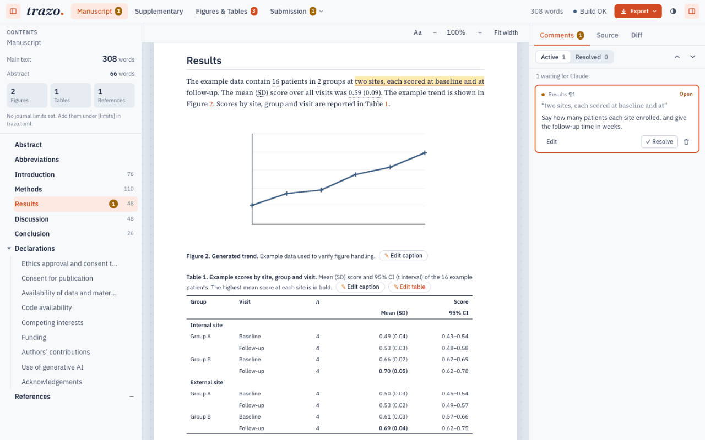

<p align="center">
  <picture>
    <source media="(prefers-color-scheme: dark)" srcset="brand/svg/trazo-wordmark-white.svg">
    
  </picture>
</p>

<p align="center">
  <b>Write your paper in plain text with an AI agent.<br>
  Get a Word file with formatted citations, numbered figures and tables,
  and numbers that come from your data.</b>
</p>

<p align="center">
  For researchers on macOS · Works in the Claude and ChatGPT desktop apps · Free and open source
</p>

<p align="center">
  <a href="#install">Install</a> ·
  <a href="#your-first-paper-in-5-minutes">Your first paper</a> ·
  <a href="#questions">Questions</a> ·
  <a href="#problems">Problems</a>
</p>

<p align="center">
  
</p>

## What you get

trazo is for writing a scientific paper for a journal, or a report, with an
AI agent at your side. You write the text in plain files and talk to the
agent in the Claude or ChatGPT app; trazo does the bookkeeping. Add a
figure, cite a new paper or update your data, and the numbers, references and cross-references in the Word
file follow along, with nothing to fix by hand.

Along the way you get:

- **A Word file you can send** to coauthors or a journal, with formatted
  citations, numbered figures and tables, and cross-references that
  renumber themselves.
- **A live preview** where you read the paper as it will look, leave
  comments for the agent on any sentence, edit the text and see what
  changed since your last version.
- **Figures and tables made from your data**, a diagram editor, and numbers
  in the text that are computed from the data instead of typed.
- **An agent that knows academic writing**: it drafts sections, adds and
  checks references, makes figures and tables, reviews the paper as a peer
  reviewer would and helps you answer the reviewers.

## Install

You need a Mac and either the [Claude desktop app](https://claude.com/download)
or the [ChatGPT desktop app](https://chatgpt.com/download). 

> [!IMPORTANT]
> Both apps need git to add the plugin. On a Mac that has never had
> developer tools, open the Terminal app, run `xcode-select --install` and accept
> Apple's dialog.

### Claude app

1. Open the **Code** tab and start a local session.
2. Choose **+** next to the prompt box, then **Plugins** › **Browse
   plugins** › **Add plugin** › **Add marketplace**, and enter this repo
   (`https://github.com/joselznom/trazo`).
3. Select **trazo** and add it. The app warns you that the plugin runs a
   local server on this computer; that is expected.
4. Start a new chat and ask the agent to *"set up trazo"*.

### ChatGPT app

1. Go to **Plugins** › **Add** › **Add a marketplace**, and enter the source
   `https://github.com/joselznom/trazo` with Git ref `main`.
2. Install **trazo** from that marketplace.
3. Start a new chat and ask the agent to *"set up trazo"*. When the app
   asks, allow the setup command and trust trazo's hook.

<details>
<summary>Install from a terminal</summary>

```bash
claude plugin marketplace add joselznom/trazo
claude plugin install trazo@trazo

codex plugin marketplace add joselznom/trazo
codex plugin add trazo@trazo
```

Then ask the agent to set up trazo, as above.

</details>

## Your first paper in 5 minutes

The best way to work is one paper per project: a folder you open in the
app, with your experiment's data inside or next to it. That way the agent can read
your data when it makes figures, tables and the numbers in the text.

1. **Create the paper.** Ask the agent something like *"create a new paper
   called 'My study' in Documents"*. It asks you three things:

   | Question | Answer |
   |---|---|
   | Kind | Article (for a journal: submission files and checklist) or report |
   | Example paper | Yes for sample text, data, a figure, a diagram, a table and a citation; no for empty sections |
   | Title | The paper's title; you can change it later |

2. **Open it as a project.** Open the new folder in the app.
3. **Open the preview.** Ask the agent to open the preview (`/trazo:open`).
4. **Review and edit.** Select a sentence, choose **Comment** and write
   what should change, then ask the agent to answer your comments
   (or `/trazo:comments`). For small changes, such as a word or a
   number, edit the Markdown yourself, in the preview's **Source** tab or
   in any text editor.
5. **Get the Word file.** In the preview, click **Export** and choose the
   full document (**Full manuscript** in an article, or press ⌘B), or ask
   the agent to build the Word files.
   They are saved in the paper's `output/` folder.

To keep versions you can go back to, ask the agent to make the folder a
git repository. The preview's **Diff** tab then shows what changed since
the last saved version.

### What is in a paper's folder

Each paper is an ordinary folder on your Mac. You will mostly work in
three places: `data/` for your files, `manuscript/` for the text, and
`output/` to pick up the Word file. The agent keeps the rest up to date.

| Folder | What it holds | Who works there |
|---|---|---|
| `manuscript/` | The text: one Markdown file per section in `main/` (introduction, methods, results...), and the title, authors and keywords in `metadata.yaml` | You and the agent |
| `data/` | Your experiment's data files, and the numbers computed from them for the text | You add the data; the agent computes |
| `bibliography/` | Your references (`references.bib`, which Zotero can export) and the citation style | Mostly the agent |
| `figures/` | The scripts that draw your plots, and your diagrams | Mostly the agent; diagrams also in the diagram editor |
| `tables/` | How each table is computed from the data and formatted | Mostly the agent |
| `notes/` | Decisions, ideas and answers to reviewers | You and the agent |
| `output/` | The Word files, ready to send | Nobody: they are rebuilt every time, so do not edit them |

The paper's own `README.md` is the full guide: writing, references,
figures, tables and a journal's format.

## Questions

- **Is it free?** Yes, trazo is free and open source. The agent runs on
  your Claude or ChatGPT account, within that plan's limits.
- **Do I need to know Markdown?** It helps. The agent writes most of the
  text, but knowing the basics (headings with `#`, *italics* with `*`,
  **bold** with `**`, lists with `-`) lets you make small changes
  yourself. The paper's `README.md` shows how citations, figures and
  tables are written.
- **My coauthors only use Word. Is that a problem?** No, send them the
  Word file. trazo does not read their edits back from Word yet, so give
  their changes to the agent and ask it to apply them.
- **Can I use my journal's citation style and Word template?** Yes, ask
  the agent, for example *"use the citation style and Word template of
  &lt;journal&gt;"*. The steps are in "Journal format" in the paper's
  `README.md`: the style comes from the
  [Zotero Style Repository](https://www.zotero.org/styles), and the
  journal's Word template, if it has one, goes in `templates/`.
- **Where do my files live?** In the paper's folder on your Mac (see
  [What is in a paper's folder](#what-is-in-a-papers-folder)). The preview
  is a page served by your own computer.
- **Does it work on Windows or Linux?** Not yet: trazo supports macOS
  only, on Apple silicon and Intel Macs.
- **How do I uninstall it?** Remove the plugin from the app; your papers
  stay as they are.
  - Claude app: **+** next to the prompt box › **Plugins**, select
    **trazo** and uninstall it.
  - ChatGPT app: **Plugins**, select **trazo** and uninstall it.
  - From a terminal: `claude plugin uninstall trazo@trazo` or
    `codex plugin remove trazo@trazo`.

## Update

Update the plugin in the app's plugin browser. The next time the preview is
open, a pill with the new version appears in its top bar: click it, then
**Update**. If you changed a file that the update also changes, you get a
`<file>.new` beside it; ask the agent to merge it.

## Problems

When something goes wrong, first ask the agent to *"check trazo"*: it runs trazo's doctor and
says what is missing and how to fix it.

| What you see | What to do |
|---|---|
| The agent has no trazo tools | Ask it to set up trazo, then start a new chat |
| "trazo is not set up on this computer" | Ask the agent to set up trazo |
| "this paper pins trazo vX, but trazo vY is set up here" | Ask the agent to update the paper |
| The preview does not appear in Claude | Click **Browser** in the toolbar to show the pane |
| The update pill says to set up trazo | The new version needs a download: ask the agent to set up trazo |
| The update pill says "Plugin" | The other app installed a newer trazo: update the plugin in this app too |
| "Chrome not found" | Ask the agent to set up trazo; it downloads a headless Chrome |

Still stuck? [Open an issue](https://github.com/joselznom/trazo/issues)
with the message and what you asked the agent.

## Contributing and licence

How the repository works, how to test a change and how to make a release
are in [CONTRIBUTING.md](CONTRIBUTING.md).

trazo is under the [MIT licence](LICENSE). The project template in
`template/` is under [MIT No Attribution](LICENSE-template), so papers made
from it need no licence notice.
